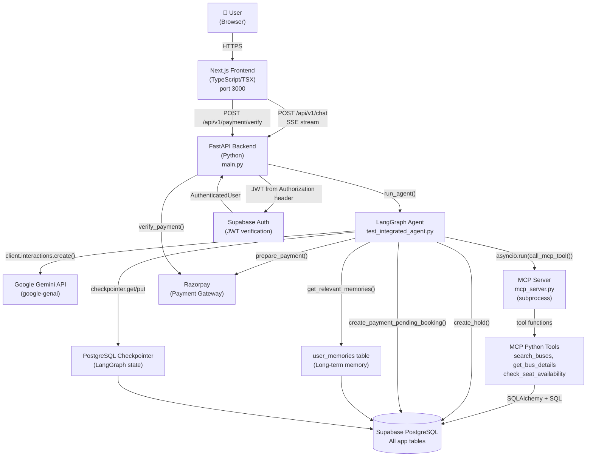
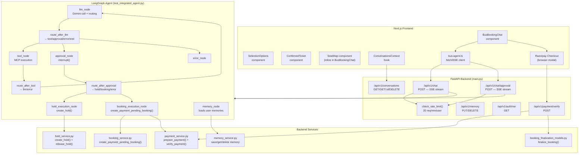

# Stage 01 — Inventory, Architecture Diagrams, and File Catalogue

## Scoring Formula (applies to all phase matrices)
- **Completion %** = Verified / Total topics
- **Implementation %** = Implemented / Total
- **Testing %** = Tested / Total
- Studied = documented evidence in repo. If no study material exists in repo: "Not determinable from repo."

---

## 1. Repository Top-Level Structure

```
Bus Booking  AI Agent/
├── .agents/skills/supabase-postgres-best-practices/   ← workspace skill
├── .env                                                ← secrets (not committed)
├── .gitignore
├── .python-version
├── .vscode/settings.json
├── bus_booking_agent_data/
│   ├── data/
│   │   ├── bus_seats_rows.csv       (100 KB)
│   │   ├── buses_rows.csv           (5 KB)
│   │   ├── fares.csv                (74 MB — 353 k rows)
│   │   ├── operators_rows.csv       (3 KB)
│   │   ├── route_stops_rows.csv     (8 KB)
│   │   ├── schedule_stops.csv       (14 MB)
│   │   └── schedules_rows.csv       (1.2 MB)
│   ├── queries.sql
│   └── schema.sql
├── docs/audit/                                         ← this audit
├── frontend/                                           ← Next.js app
├── main.py                                             ← PRODUCTION FastAPI entry point
├── pyproject.toml
├── README.md
├── skills-lock.json
├── src/bus_booking_ai_agent/                           ← Python package
│   ├── auth/
│   ├── config/
│   ├── phase_01_llm_fundamentals/
│   ├── phase_02_context_engineering/
│   ├── phase_03_mcp/
│   ├── phase_04_langgraph/
│   ├── phase_05_memory/
│   ├── phase_06_security/
│   └── services/
├── tests/
├── WALKTHROUGH.md
└── uv.lock
```

---

## 2. The 14 Phase Directories

| Phase Dir | Files Found | Status |
|---|---|---|
| `phase_01_llm_fundamentals/` | context_window.py, conversation_history.py, llm_integration.py, multi_turn.py, structured_output.py, system_instructions.py, test.py, tokens.py, token_counting.py, user_messages.py | Has study/experiment scripts |
| `phase_02_context_engineering/` | agent_context.py, context_compression.py, context_formatter.py, context_injection.py, context_management.py, context_ordering.py, context_prioritization.py, context_selection.py, context_sources.py | Has study/experiment scripts |
| `phase_03_mcp/` | mcp_client.py, mcp_server.py (in server/), tools/ | Production tools |
| `phase_04_langgraph/` | test_integrated_agent.py (the **production agent**), step_events.py, + 10 learning experiment files | Production agent + experiments |
| `phase_05_memory/` | memory_service.py, memory_context.py, memory_safety.py, models.py + 2 test files | Production memory |
| `phase_06_security/` | rate_limiter.py, test_rate_limiter.py | Production rate limiter |
| Phases 07–14 | No dedicated directories exist in `src/` | Features in production code but no phase dirs |

---

## 3. File Inventory Table

| Path | Responsibility | Phase | Used in Running App? | Tests? | Status |
|---|---|---|---|---|---|
| `main.py` | FastAPI app, all HTTP endpoints, SSE streaming, chat+approval flow | 03,04,05,06 | ✅ YES — entry point | Partial | **Active production** |
| `frontend/main.py` | Diverged copy of root main.py for frontend dev server use | 03,04 | ✅ Diverged copy | Partial | **Active (diverged)** |
| `src/.../phase_04_langgraph/test_integrated_agent.py` | LangGraph agent, graph, nodes, Gemini interaction, HITL, checkpointing | 03,04,05,06,07 | ✅ YES — imported by main.py:17-21 | Partial | **Active production** (misnamed as "test") |
| `src/.../phase_03_mcp/server/mcp_server.py` | MCP server: registers search_buses_tool, get_bus_details_tool, check_seat_availability_tool | 03 | ✅ YES — spawned as subprocess | None | **Active production** |
| `src/.../phase_03_mcp/mcp_client.py` | MCP client library (not the one used in production — see test_integrated_agent.py) | 03 | ⚠️ NOT imported by main.py | None | **Experiment/unused** |
| `src/.../phase_03_mcp/tools/search_buses.py` | Search buses SQL tool (12 KB) | 03 | ✅ YES — called by mcp_server.py | tests/test_search_buses.py, test_segment_search.py | **Active production** |
| `src/.../phase_03_mcp/tools/get_bus_details.py` | Get bus+stop details SQL tool | 03 | ✅ YES | None direct | **Active production** |
| `src/.../phase_03_mcp/tools/check_seat_availability.py` | Seat availability SQL, all seats + status | 03 | ✅ YES | tests/test_seat_availability.py | **Active production** |
| `src/.../phase_03_mcp/tools/create_seat_hold.py` | Tool definition + validation for HITL hold trigger | 03,07 | ✅ YES — imported by agent | tests/ indirectly | **Active production** |
| `src/.../phase_03_mcp/tools/create_booking.py` | Tool definition + validation for HITL booking trigger | 03,07 | ✅ YES — imported by agent | tests/ indirectly | **Active production** |
| `src/.../phase_03_mcp/tools/schedule_time_utils.py` | Day-offset time display utilities | 03 | ✅ YES | tests/test_schedule_time_utils.py | **Active production** |
| `src/.../phase_04_langgraph/step_events.py` | Thread-local SSE step event emitter | 04 | ✅ YES | None | **Active production** |
| `src/.../phase_04_langgraph/test_agent_loop.py` | Learning experiment: agent loop | 04 | ❌ Not imported by main.py | Standalone | **Experiment** |
| `src/.../phase_04_langgraph/test_error_handling.py` | Learning experiment: error routing | 04 | ❌ | Standalone | **Experiment** |
| `src/.../phase_04_langgraph/test_first_graph.py` | Learning experiment: first LangGraph graph | 04 | ❌ | Standalone | **Experiment** |
| `src/.../phase_04_langgraph/test_human_in_the_loop.py` | Learning experiment: HITL with interrupt | 04 | ❌ | Standalone | **Experiment** |
| `src/.../phase_04_langgraph/test_llm_node.py` | Learning experiment | 04 | ❌ | Standalone | **Experiment** |
| `src/.../phase_04_langgraph/test_max_iterations.py` | Learning experiment | 04 | ❌ | Standalone | **Experiment** |
| `src/.../phase_04_langgraph/test_mcp_langgraph.py` | Learning experiment: MCP+LangGraph | 04 | ❌ | Standalone | **Experiment** |
| `src/.../phase_04_langgraph/test_retry_logic.py` | Learning experiment | 04 | ❌ | Standalone | **Experiment** |
| `src/.../phase_04_langgraph/test_tool_node.py` | Learning experiment | 04 | ❌ | Standalone | **Experiment** |
| `src/.../phase_04_langgraph/test_tool_routing.py` | Learning experiment | 04 | ❌ | Standalone | **Experiment** |
| `src/.../phase_05_memory/memory_service.py` | PostgreSQL-backed user memory CRUD | 05 | ✅ YES | tests/test_seat_hold_workflow.py indirectly | **Active production** |
| `src/.../phase_05_memory/memory_context.py` | get_relevant_memories() — retrieves for agent | 05 | ✅ YES — imported by agent:35-37 | None | **Active production** |
| `src/.../phase_05_memory/memory_safety.py` | validate_memory_value() | 05,06 | ✅ YES | None | **Active production** |
| `src/.../phase_05_memory/models.py` | Memory Pydantic models | 05 | ⚠️ Likely unused (service uses plain dicts) | None | **Possibly unused** |
| `src/.../phase_05_memory/test_persistent_agent_state.py` | Learning experiment: state persistence | 05 | ❌ | Standalone | **Experiment** |
| `src/.../phase_05_memory/test_short_term_memory.py` | Learning experiment: short-term memory | 05 | ❌ | Standalone | **Experiment** |
| `src/.../phase_06_security/rate_limiter.py` | Redis/in-memory rate limiter | 06 | ✅ YES — imported by main.py:37-39 | test_rate_limiter.py | **Active production** |
| `src/.../phase_06_security/test_rate_limiter.py` | Rate limiter unit test | 06 | ❌ | tests/test_rate_limiter.py | **Active test** |
| `src/.../services/booking_service.py` | create_payment_pending_booking() | 07 | ✅ YES | tests/test_booking_workflow.py | **Active production** |
| `src/.../services/hold_service.py` | create_hold(), release_hold() with advisory lock | 07,11 | ✅ YES | tests/test_seat_hold_workflow.py | **Active production** |
| `src/.../services/payment_service.py` | prepare_payment(), verify_payment() | - | ✅ YES | tests/test_booking_workflow.py | **Active production** |
| `src/.../services/payment_models.py` | Pydantic payment models | - | ✅ YES | None | **Active production** |
| `src/.../services/booking_models.py` | Pydantic booking models | - | ✅ YES | None | **Active production** |
| `src/.../services/hold_models.py` | Pydantic hold models | - | ✅ YES | None | **Active production** |
| `src/.../services/booking_finalization_models.py` | finalize_booking() logic | - | ✅ YES | test_booking_finalization.py | **Active production** |
| `src/.../services/razorpay_provider.py` | Razorpay API wrapper | - | ✅ YES | None (requires live Razorpay) | **Active production** |
| `src/.../auth/verifier.py` | JWT verification via Supabase | 06 | ✅ YES | None | **Active production** |
| `src/.../auth/models.py` | AuthenticatedUser Pydantic model | 06 | ✅ YES | None | **Active production** |
| `src/.../auth/dependencies.py` | get_current_user FastAPI dependency | 06 | ✅ YES | None | **Active production** |
| `src/.../config/database.py` | SQLAlchemy engine for PostgreSQL | all | ✅ YES | None | **Active production** |
| `src/.../config/gemini.py` | Google GenAI client, MODEL config | 01 | ✅ YES | None | **Active production** |
| `src/.../config/upstash_redis.py` | Redis client config | 06,12 | ✅ YES (if rate limiter uses it) | None | **Active production** |
| `bus_booking_agent_data/schema.sql` | Full DB schema (13 tables + RLS) | 02,06 | Reference | None | **Authoritative schema** |
| `bus_booking_agent_data/queries.sql` | Reference queries | 03 | Reference | None | **Reference** |
| `tests/test_booking_workflow.py` | Integration tests: booking + payment API (18 KB) | 07,08 | Test suite | ✅ | **Active test** |
| `tests/test_chat_components.py` | Frontend component behavior via Python | UI | Test suite | ✅ | **Active test** |
| `tests/test_chat_options.py` | Options payload tests | UI | Test suite | ✅ | **Active test** |
| `tests/test_confirmed_ticket_times.py` | Ticket time display tests | 03 | Test suite | ✅ | **Active test** |
| `tests/test_conversations_api.py` | Conversations REST API (14 KB) | 05 | Test suite | ⚠️ 2 pre-existing failures | **Active test (partial)** |
| `tests/test_hold_expiry.py` | Hold expiry logic | 07,11 | Test suite | ✅ | **Active test** |
| `tests/test_schedule_time_utils.py` | Time utility tests | 03 | Test suite | ✅ | **Active test** |
| `tests/test_search_buses.py` | search_buses tool tests | 03 | Test suite | ✅ | **Active test** |
| `tests/test_seat_availability.py` | Seat availability tests | 03 | Test suite | ✅ | **Active test** |
| `tests/test_seat_hold_workflow.py` | Full hold workflow integration (45 KB) | 07,11 | Test suite | ✅ | **Active test** |
| `tests/test_seat_map.py` | Seat map rendering tests | UI,03 | Test suite | ⚠️ 1 pre-existing failure | **Active test (partial)** |
| `tests/test_segment_search.py` | Segment-aware search tests | 03 | Test suite | ✅ | **Active test** |
| `src/.../services/test_booking_finalization.py` | Booking finalization tests | 07 | Test suite | ✅ | **Active test** |
| `frontend/` | Next.js TypeScript app | UI | ✅ YES | TypeScript build | **Active production** |
| `WALKTHROUGH.md` | Implementation documentation | - | Reference | None | **Documentation** |
| `pyproject.toml` | Python package config + dependencies | - | Reference | None | **Config** |

---

## 4. Import Chain: Entry Point to Production Components

```
HTTP Request
    ↓
main.py:105  — FastAPI app = FastAPI(...)
main.py:17   — from phase_04_langgraph.test_integrated_agent import checkpointer, graph, run_agent
    ↓
test_integrated_agent.py:14   — from langgraph.checkpoint.postgres import PostgresSaver
test_integrated_agent.py:34   — from config.gemini import MODEL, client
test_integrated_agent.py:38   — from phase_03_mcp.tools.create_seat_hold import ...
test_integrated_agent.py:45   — from phase_03_mcp.tools.create_booking import ...
test_integrated_agent.py:52   — from services.booking_service import ...
test_integrated_agent.py:61   — from services.payment_service import ...
test_integrated_agent.py:67   — from services.hold_service import ...
test_integrated_agent.py:3570 — checkpointer = PostgresSaver(checkpoint_pool)  ← ACTIVE checkpointer
test_integrated_agent.py:3576 — graph = builder.compile(checkpointer=checkpointer)
```

**Key finding:** `phase_03_mcp/mcp_client.py` is NOT imported by `main.py` or `test_integrated_agent.py`. The production MCP client is defined **inline** at `test_integrated_agent.py:801` (`call_mcp_tool()`) which spawns the MCP server as a subprocess per tool call using the `mcp` library's `stdio_client`.

---

## 5. MCP Tools Actually Registered

The MCP server (`phase_03_mcp/server/mcp_server.py`) registers:
1. `search_buses_tool` → maps to `search_buses.py`
2. `get_bus_details_tool` → maps to `get_bus_details.py`
3. `check_seat_availability_tool` → maps to `check_seat_availability.py`

The agent also defines two **action tools** (not MCP tools — they trigger HITL workflows):
4. `create_seat_hold` (defined in `create_seat_hold.py`, handled in `llm_node`)
5. `create_payment_pending_booking` (defined in `create_booking.py`, handled in `llm_node`)

**Total tools Gemini sees:** 5  
**Total tools going through MCP subprocess:** 3  
**Action tools (HITL, not through MCP):** 2

---

## 6. Duplicates, Dead Code, and Concerns

| Issue | Location | Severity |
|---|---|---|
| `phase_03_mcp/mcp_client.py` is NOT used in production | mcp_client.py | Low — it is a learning artifact |
| `frontend/main.py` is a diverged copy of `main.py` | frontend/main.py | Medium — two versions of the same file |
| `test_integrated_agent.py` is production code, not a test file | phase_04_langgraph/ | Low — naming is misleading |
| `src/.../phase_05_memory/models.py` appears unused | models.py | Low — verify import usage |
| Phase 01/02 files are standalone experiments | phase_01_*, phase_02_* | Low — intentional learning artifacts |
| No dedicated directories for Phases 07–14 | src/ | Low — features are in production code |
| MCP subprocess spawned per-call | test_integrated_agent.py:817 | Medium performance issue |

---

## 7. Git Summary

```
Current branch: main
Latest commits:
  9846fff  Update code
  ff4d228  Updated data
  828f4fa  Improved latency
  a6d0390  feat: segment-aware bus search and UI refinements
  19923d2  Improve booking chat selection flow
  ad1ae47  feat: add interactive bus seat maps
  b3afaa1  Add seat map
  a094e10  feat(agent): stream live agent execution steps via SSE
  2caf6d6  feat(chat): add soft deletion and turn-based conversation history
  60b75a4  feat: persistent chat history, natural stop resolution, chat UI
```

---

## Diagram A — High-Level System Architecture



---

## Diagram B — Detailed Component Architecture


