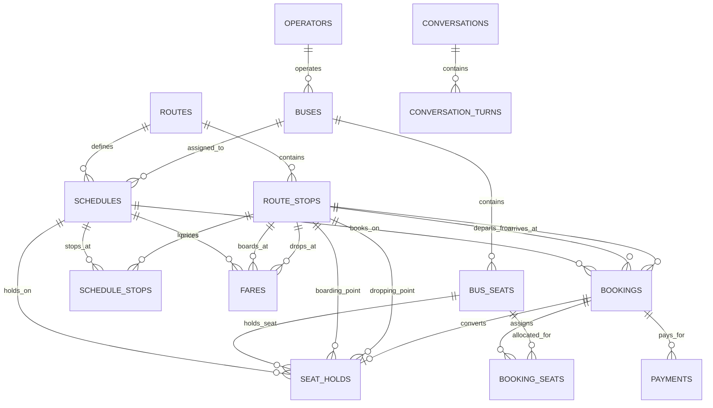

# Stage 02 — Database and SQL Audit

## 1. Table Catalogue & Schema Audit

Every table referenced in the codebase, schema, and application queries is analyzed below.

---

### Table 1: `operators`
- **Location in Schema**: `bus_booking_agent_data/schema.sql:7-21`
- **Purpose**: Stores private and state bus operating agencies (e.g. TSRTC, Orange Tours, Morning Star).
- **Primary Key**: `id` (`uuid`, default `gen_random_uuid()`)
- **Foreign Keys**: None.
- **Unique Constraints**: `code text not null unique`
- **Check Constraints**:
  - `operators_brand_tier_check check (brand_tier in ('PREMIUM', 'STANDARD', 'BUDGET'))`
- **Indexes**: None explicit in `schema.sql` besides PK and unique index on `code`.
- **Row-Level Security**: None defined in schema.
- **Relationships**:
  - Referenced by `buses.operator_id` (1:N)
- **Read by**: `bus_booking_agent_data/queries.sql`, `phase_03_mcp/tools/search_buses.py`, `phase_03_mcp/tools/get_bus_details.py`, `main.py:431` (`GET_CONFIRMED_TICKET_SQL`).
- **Written by**: DB seed / migrations only.

---

### Table 2: `buses`
- **Location in Schema**: `bus_booking_agent_data/schema.sql:26-45`
- **Purpose**: Represents physical bus fleet inventory with physical capacities and amenities.
- **Primary Key**: `id` (`uuid`, default `gen_random_uuid()`)
- **Foreign Keys**: `operator_id` references `operators(id)`.
- **Unique Constraints**: `bus_number text not null unique`
- **Check Constraints**:
  - `total_seats > 0`
  - `buses_bus_type_check check (bus_type in ('AC Sleeper', 'Non-AC Sleeper', 'AC Seater', 'Non-AC Seater', 'Volvo AC', 'AC Semi-Sleeper'))`
- **Indexes**: None explicit besides PK and unique index on `bus_number`.
- **Row-Level Security**: None defined in schema.
- **Relationships**:
  - Belongs to `operators` (N:1)
  - Referenced by `bus_seats.bus_id` (1:N)
  - Referenced by `schedules.bus_id` (1:N)
- **Read by**: `search_buses.py`, `get_bus_details.py`, `check_seat_availability.py`, `hold_service.py:173`, `main.py:430`.
- **Written by**: DB seed / migrations only.

---

### Table 3: `bus_seats`
- **Location in Schema**: `bus_booking_agent_data/schema.sql:49-62`
- **Purpose**: Physical seat configurations of each bus. Does **not** store availability flags; availability is purely derived per schedule.
- **Primary Key**: `id` (`uuid`, default `gen_random_uuid()`)
- **Foreign Keys**: `bus_id` references `buses(id)`.
- **Unique Constraints**: `(bus_id, seat_number)` (`bus_seats_bus_id_seat_number_key`)
- **Check Constraints**:
  - `bus_seats_seat_type_check check (seat_type in ('SEATER', 'LOWER', 'UPPER'))`
- **Indexes**: `idx_bus_seats_bus_id on bus_seats (bus_id)` (`schema.sql:328`)
- **Row-Level Security**: None.
- **Relationships**:
  - Belongs to `buses` (N:1)
  - Referenced by `booking_seats.seat_id` (1:N)
  - Referenced by `seat_holds.seat_id` (1:N)
- **Read by**: `check_seat_availability.py:107`, `hold_service.py:173`, `booking_service.py:84`, `main.py:428`.
- **Written by**: DB seed / migrations only.

---

### Table 4: `routes`
- **Location in Schema**: `bus_booking_agent_data/schema.sql:67-78`
- **Purpose**: Master inter-city travel routes defining overall origins, destinations, distance, and expected duration.
- **Primary Key**: `id` (`uuid`, default `gen_random_uuid()`)
- **Foreign Keys**: None.
- **Unique Constraints**: None.
- **Check Constraints**:
  - `distance_km > 0`
  - `estimated_duration_minutes > 0`
  - `routes_origin_destination_check check (origin <> destination)`
- **Indexes**: None explicit in `schema.sql`.
- **Row-Level Security**: None.
- **Relationships**:
  - Referenced by `route_stops.route_id` (1:N)
  - Referenced by `schedules.route_id` (1:N)
- **Read by**: `search_buses.py`, `get_bus_details.py`, `main.py:432`.
- **Written by**: DB seed / migrations only.

---

### Table 5: `route_stops`
- **Location in Schema**: `bus_booking_agent_data/schema.sql:83-97`
- **Purpose**: Ordered pickup and drop-off points along a route, with sequence numbers and boarding/dropping eligibility flags.
- **Primary Key**: `id` (`uuid`, default `gen_random_uuid()`)
- **Foreign Keys**: `route_id` references `routes(id)`.
- **Unique Constraints**: `(route_id, sequence_number)` (`route_stops_route_id_sequence_number_key`)
- **Check Constraints**: None.
- **Indexes**:
  - `idx_route_stops_route_id on route_stops (route_id)` (`schema.sql:318`)
  - `idx_route_stops_city on route_stops (city)` (`schema.sql:319`)
- **Row-Level Security**: None.
- **Relationships**:
  - Belongs to `routes` (N:1)
  - Referenced by `schedule_stops.route_stop_id` (1:N)
  - Referenced by `fares.boarding_stop_id`, `fares.dropping_stop_id` (1:N)
  - Referenced by `seat_holds.boarding_stop_id`, `seat_holds.dropping_stop_id` (1:N)
  - Referenced by `bookings.boarding_stop_id`, `bookings.dropping_stop_id` (1:N)
- **Read by**: `search_buses.py`, `get_bus_details.py`, `check_seat_availability.py`, `hold_service.py`, `booking_service.py`, `main.py:433-434`.
- **Written by**: DB seed / migrations only.

---

### Table 6: `schedule_templates`
- **Status**: **Not found** in `schema.sql` or Python codebase.
- **Notes**: The application schedules are concrete instances stored in `schedules`. No recurring recurrence template table was implemented.

---

### Table 7: `schedules`
- **Location in Schema**: `bus_booking_agent_data/schema.sql:102-114`
- **Purpose**: A concrete scheduled bus trip operating on a specific calendar travel date.
- **Primary Key**: `id` (`uuid`, default `gen_random_uuid()`)
- **Foreign Keys**:
  - `bus_id` references `buses(id)`
  - `route_id` references `routes(id)`
- **Unique Constraints**: `(bus_id, route_id, travel_date)` (`schedules_bus_route_date_key`)
- **Check Constraints**:
  - `schedules_status_check check (status in ('SCHEDULED', 'CANCELLED', 'COMPLETED'))`
- **Indexes**:
  - `idx_schedules_route_id on schedules (route_id)` (`schema.sql:313`)
  - `idx_schedules_bus_id on schedules (bus_id)` (`schema.sql:314`)
  - `idx_schedules_travel_date on schedules (travel_date)` (`schema.sql:315`)
  - `idx_schedules_status on schedules (status)` (`schema.sql:316`)
- **Row-Level Security**: None.
- **Relationships**:
  - Belongs to `buses` (N:1) and `routes` (N:1)
  - Referenced by `schedule_stops.schedule_id` (1:N)
  - Referenced by `fares.schedule_id` (1:N)
  - Referenced by `seat_holds.schedule_id` (1:N)
  - Referenced by `bookings.schedule_id` (1:N)
- **Read by**: `search_buses.py`, `get_bus_details.py`, `check_seat_availability.py`, `hold_service.py`, `booking_service.py`, `main.py:429`.
- **Written by**: DB seed / migrations only.

---

### Table 8: `schedule_stops`
- **Location in Schema**: `bus_booking_agent_data/schema.sql:120-131`
- **Purpose**: Trip-specific arrival and departure times for each route stop on a schedule, with trip-specific boarding/dropping allowance.
- **Primary Key**: `id` (`uuid`, default `gen_random_uuid()`)
- **Foreign Keys**:
  - `schedule_id` references `schedules(id)`
  - `route_stop_id` references `route_stops(id)`
- **Unique Constraints**: `(schedule_id, route_stop_id)` (`schedule_stops_schedule_id_route_stop_id_key`)
- **Check Constraints**: None.
- **Indexes**:
  - `idx_schedule_stops_schedule_id on schedule_stops (schedule_id)` (`schema.sql:321`)
  - `idx_schedule_stops_route_stop_id on schedule_stops (route_stop_id)` (`schema.sql:322`)
- **Row-Level Security**: None.
- **Relationships**:
  - Links `schedules` and `route_stops` (M:N)
- **Read by**: `search_buses.py`, `get_bus_details.py`, `check_seat_availability.py`, `hold_service.py:64-76`, `main.py:359-405`.
- **Written by**: DB seed / migrations only.

---

### Table 9: `fares`
- **Location in Schema**: `bus_booking_agent_data/schema.sql:136-157`
- **Purpose**: Authoritative segment-based ticket price attaching to a unique tuple of `(schedule_id, boarding_stop_id, dropping_stop_id)`.
- **Primary Key**: `id` (`uuid`, default `gen_random_uuid()`)
- **Foreign Keys**:
  - `schedule_id` references `schedules(id)`
  - `boarding_stop_id` references `route_stops(id)`
  - `dropping_stop_id` references `route_stops(id)`
- **Unique Constraints**: `(schedule_id, boarding_stop_id, dropping_stop_id)` (`fares_schedule_boarding_dropping_key`)
- **Check Constraints**:
  - `amount > 0`
  - `fares_boarding_dropping_distinct_check check (boarding_stop_id <> dropping_stop_id)`
- **Indexes**:
  - `idx_fares_schedule_id on fares (schedule_id)` (`schema.sql:324`)
  - `idx_fares_boarding_stop_id on fares (boarding_stop_id)` (`schema.sql:325`)
  - `idx_fares_dropping_stop_id on fares (dropping_stop_id)` (`schema.sql:326`)
- **Row-Level Security**: None.
- **Relationships**:
  - Links `schedules` and two `route_stops` rows.
- **Read by**: `search_buses.py:127-133`, `booking_service.py:87-92`.
- **Written by**: DB seed / migrations only.

---

### Table 10: `seat_holds`
- **Location in Schema**: `bus_booking_agent_data/schema.sql:214-306`
- **Purpose**: Temporary 10-minute pessimistic holds placed on a physical seat for an authenticated user on a specific journey segment.
- **Primary Key**: `id` (`uuid`, default `gen_random_uuid()`)
- **Foreign Keys**:
  - `schedule_id` references `schedules(id)`
  - `seat_id` references `bus_seats(id)`
  - `boarding_stop_id` references `route_stops(id)`
  - `dropping_stop_id` references `route_stops(id)`
  - `booking_id` references `bookings(id)` (nullable)
- **Unique Constraints**: None (multiple holds can exist historically on a seat).
- **Check Constraints**:
  - `seat_holds_valid_sequence check (boarding_sequence < dropping_sequence)`
  - `seat_holds_valid_expiration check (expires_at > created_at)`
  - `seat_holds_released_timestamp check (status <> 'RELEASED' or released_at is not null)`
  - `seat_holds_converted_timestamp check (status <> 'CONVERTED' or converted_at is not null)`
  - `seat_holds_converted_booking check (status <> 'CONVERTED' or booking_id is not null)`
- **Indexes**:
  - `idx_seat_holds_schedule_seat on seat_holds (schedule_id, seat_id)` (`schema.sql:338`)
  - `idx_seat_holds_user on seat_holds (auth_user_id)` (`schema.sql:341`)
  - `idx_seat_holds_status_expiration on seat_holds (status, expires_at)` (`schema.sql:344`)
  - `idx_seat_holds_schedule_segment on seat_holds (schedule_id, seat_id, boarding_sequence, dropping_sequence)` (`schema.sql:347`)
  - `idx_seat_holds_booking on seat_holds (booking_id)` (`schema.sql:356`)
- **Row-Level Security**: None defined in schema file.
- **Relationships**:
  - Foreign keys to `schedules`, `bus_seats`, `route_stops` (x2), and `bookings`.
- **Read by**: `check_seat_availability.py:83-97`, `hold_service.py:268-289`, `booking_service.py:57-96`, `booking_finalization_models.py:87-115`, `main.py:1542`.
- **Written by**: `hold_service.py:405-453` (`INSERT`), `hold_service.py:473-483` (`UPDATE status='RELEASED'`), `booking_finalization_models.py:192-202` (`UPDATE status='CONVERTED'`).

---

### Table 11: `bookings`
- **Location in Schema**: `bus_booking_agent_data/schema.sql:162-179`
- **Purpose**: Authoritative booking records created in `PAYMENT_PENDING` status upon passenger detail confirmation, transitioned to `CONFIRMED` upon payment verification.
- **Primary Key**: `id` (`uuid`, default `gen_random_uuid()`)
- **Foreign Keys**:
  - `schedule_id` references `schedules(id)`
  - `boarding_stop_id` references `route_stops(id)`
  - `dropping_stop_id` references `route_stops(id)`
- **Unique Constraints**: `booking_reference text not null unique`
- **Check Constraints**:
  - `passenger_count > 0`
  - `total_amount >= 0`
  - `bookings_status_check check (status in ('CONFIRMED', 'CANCELLED'))`  ⚠️ **INCONSISTENCY**: Service code inserts `'PAYMENT_PENDING'`!
- **Indexes**:
  - `idx_bookings_auth_user_id on bookings (auth_user_id)` (`schema.sql:330`)
  - `idx_bookings_schedule_id on bookings (schedule_id)` (`schema.sql:331`)
  - `idx_bookings_status on bookings (status)` (`schema.sql:332`)
- **Row-Level Security**: None defined in schema file.
- **Relationships**:
  - Referenced by `booking_seats.booking_id` (1:N)
  - Referenced by `payments.booking_id` (1:N)
  - Referenced by `seat_holds.booking_id` (1:1)
- **Read by**: `check_seat_availability.py`, `hold_service.py`, `booking_service.py`, `payment_service.py:95-104`, `booking_finalization_models.py:59-79`, `main.py:407-442`.
- **Written by**: `booking_service.py:137-174` (`INSERT`), `booking_finalization_models.py:141-150` (`UPDATE status='CONFIRMED'`).

---

### Table 12: `booking_seats`
- **Location in Schema**: `bus_booking_agent_data/schema.sql:184-195`
- **Purpose**: Specific passenger name, age, gender, and individual fare bound to a booked physical seat.
- **Primary Key**: `id` (`uuid`, default `gen_random_uuid()`)
- **Foreign Keys**:
  - `booking_id` references `bookings(id)`
  - `seat_id` references `bus_seats(id)`
- **Unique Constraints**: `(booking_id, seat_id)` (`booking_seats_booking_id_seat_id_key`)
- **Check Constraints**:
  - `passenger_age > 0`
  - `fare >= 0`
  - `booking_seats_gender_check check (passenger_gender in ('MALE', 'FEMALE', 'OTHER'))`
- **Indexes**:
  - `idx_booking_seats_booking_id on booking_seats (booking_id)` (`schema.sql:334`)
  - `idx_booking_seats_seat_id on booking_seats (seat_id)` (`schema.sql:335`)
- **Row-Level Security**: None.
- **Relationships**:
  - Belongs to `bookings` (N:1) and `bus_seats` (N:1)
- **Read by**: `check_seat_availability.py:61-80`, `hold_service.py:219-249`, `booking_service.py:108-127`, `booking_finalization_models.py:123-133`, `main.py:427`.
- **Written by**: `booking_service.py:183-212` (`INSERT`).

---

### Table 13: `payments`
- **Location in Schema**: ⚠️ **MISSING from `schema.sql`** (created out-of-band in Supabase).
- **Structure (derived from `payment_service.py:112-198` and `booking_finalization_models.py:59-79`)**:
  - `id` (`uuid primary key`)
  - `booking_id` (`uuid not null references bookings(id)`)
  - `provider` (`text not null`, e.g. `'razorpay'`)
  - `provider_order_id` (`text not null`)
  - `provider_payment_id` (`text`)
  - `amount` (`numeric not null`)
  - `currency` (`text not null default 'INR'`)
  - `status` (`text not null`, values: `'CREATED'`, `'PENDING'`, `'SUCCESS'`, `'FAILED'`)
  - `created_at` (`timestamptz not null default now()`)
  - `paid_at` (`timestamptz`)
- **Row-Level Security**: Present in Supabase instance.
- **Read by**: `payment_service.py`, `booking_finalization_models.py`, `main.py:1547`.
- **Written by**: `payment_service.py:112` (`INSERT`), `payment_service.py:181` (`UPDATE status='SUCCESS'`).

---

### Table 14: `conversations`
- **Location in Schema**: `bus_booking_agent_data/schema.sql:364-371`
- **Purpose**: Persisted chat threads for the Next.js sidebar, linked to Supabase Auth users.
- **Primary Key**: `id` (`uuid primary key default gen_random_uuid()`)
- **Foreign Keys**: `auth_user_id references auth.users(id) on delete cascade`
- **Unique Constraints**: None.
- **Check Constraints**: None.
- **Indexes**:
  - `idx_conversations_user_active on conversations (auth_user_id, updated_at desc, id desc) where not is_deleted` (`schema.sql:374-376`)
- **Row-Level Security**:
  - `alter table conversations enable row level security;` (`schema.sql:401`)
  - Policy `conversations_owner_all` (`schema.sql:405-408`):
    `using (auth_user_id = auth.uid() and not is_deleted) with check (auth_user_id = auth.uid())`
- **Read by**: `main.py:698, 756, 1248, 1373, 1450`.
- **Written by**: `main.py:718` (`INSERT`), `main.py:814` (`UPDATE updated_at`), soft-deletion endpoints (`UPDATE is_deleted = TRUE`).

---

### Table 15: `conversation_turns`
- **Location in Schema**: `bus_booking_agent_data/schema.sql:382-393`
- **Purpose**: Stores individual conversation dialogue turns (user input + assistant response + UI options/steps metadata).
- **Primary Key**: `id` (`uuid primary key default gen_random_uuid()`)
- **Foreign Keys**: `conversation_id references conversations(id) on delete cascade`
- **Unique Constraints**: `(conversation_id, turn_number)` (`conversation_turns_unique_turn`)
- **Check Constraints**:
  - `conversation_turns_not_empty check (user_message is not null or assistant_message is not null)`
- **Indexes**: Created implicitly by unique constraint `(conversation_id, turn_number)`.
- **Row-Level Security**:
  - Policy `conversation_turns_owner_all` (`schema.sql:410-424`): checks `conversation_id in (select id from conversations where auth_user_id = auth.uid() and not is_deleted)`.
- **Read by**: `main.py:1380, 1463`.
- **Written by**: `main.py:766` (`INSERT pending turn`), `main.py:801` (`UPDATE assistant_message + metadata`).

---

### Table 16: `user_memories`
- **Location in Schema**: ⚠️ **MISSING from `schema.sql`** (defined in `phase_05_memory/memory_service.py:9-38`).
- **Structure**:
  - `id` (`uuid primary key default gen_random_uuid()`)
  - `user_id` (`text / uuid not null`)
  - `memory_type` (`text not null`)
  - `memory_key` (`text not null`)
  - `memory_value` (`text not null`)
  - `created_at` (`timestamptz not null default now()`)
  - `updated_at` (`timestamptz not null default now()`)
  - **Unique Constraint**: `(user_id, memory_type, memory_key)` (used by `ON CONFLICT DO UPDATE`)
- **Row-Level Security**: Enforced in application code by filtering `user_id = current_user.id`.
- **Read by**: `memory_service.py:41-71`, `memory_context.py:10-25`.
- **Written by**: `memory_service.py:9-38` (`INSERT ... ON CONFLICT DO UPDATE`), `memory_service.py:74-81` (`DELETE`).

---

### Tables 17–20: LangGraph Checkpoint Tables
- **Names**: `checkpoints`, `checkpoint_blobs`, `checkpoint_writes`, `checkpoint_migrations`
- **Location in Schema**: ⚠️ **Not in `schema.sql`**; automatically created by `langgraph.checkpoint.postgres.PostgresSaver.setup()` at `test_integrated_agent.py:3571`.
- **Purpose**: Persists LangGraph agent state graphs, thread execution points, and pending interrupts across turns and restarts.
- **Read/Written by**: `langgraph.checkpoint.postgres.PostgresSaver`.

---

## 2. Entity-Relationship Diagram (from Schema Foreign Keys)



---

## 3. Deep-Dive Investigations

### 3.1 Journey Segment Logic & Sequence Numbers

A route is defined as a series of stops ordered by `route_stops.sequence_number` (an integer: 1, 2, 3...).
A segment is defined by a pair of stops: `(boarding_stop, dropping_stop)`.

**Validation Rules Enforced in SQL & Python:**
1. **Sequence order**: `boarding.sequence_number < dropping.sequence_number`. A passenger cannot book backwards on a one-way schedule.
2. **Permission flags**: `schedule_stops.is_boarding_allowed = TRUE` for boarding stop, and `schedule_stops.is_dropping_allowed = TRUE` for dropping stop.
3. **Route membership**: Both stops must belong to the same schedule's route (`schedule_stops.schedule_id = s.id`).

```sql
-- Validating journey segment in check_seat_availability.py:19-48
SELECT
    boarding.sequence_number AS boarding_sequence,
    dropping.sequence_number AS dropping_sequence,
    boarding_schedule_stop.is_boarding_allowed AS boarding_allowed,
    dropping_schedule_stop.is_dropping_allowed AS dropping_allowed
FROM schedules s
JOIN schedule_stops boarding_schedule_stop ON boarding_schedule_stop.schedule_id = s.id
JOIN route_stops boarding ON boarding.id = boarding_schedule_stop.route_stop_id
JOIN schedule_stops dropping_schedule_stop ON dropping_schedule_stop.schedule_id = s.id
JOIN route_stops dropping ON dropping.id = dropping_schedule_stop.route_stop_id
WHERE s.id = :schedule_id
  AND boarding.id = :boarding_stop_id
  AND dropping.id = :dropping_stop_id;
```

---

### 3.2 Seat Availability SQL & Overlapping Journey Detection

A seat on a bus is **not** globally booked or available for the entire day. It is available or unavailable for a **specific sub-journey segment**.

#### The Segment Overlap Formula
Two segments `[B1, D1]` and `[B2, D2]` on an ordered route overlap if and only if:
$$\text{Existing Boarding} < \text{Requested Dropping} \quad \text{AND} \quad \text{Existing Dropping} > \text{Requested Boarding}$$

#### Concrete Example Walkthrough:
Consider Route Hyderabad → Vijayawada with stops:
1. Hyderabad (Seq 1)
2. Suryapet (Seq 2)
3. Kodad (Seq 3)
4. Vijayawada (Seq 4)

Seat `1A` is booked for passenger Alice from **Hyderabad (Seq 1) to Suryapet (Seq 2)**.
- Existing: $B_1 = 1$, $D_1 = 2$.

Now, Bob requests Seat `1A` from **Suryapet (Seq 2) to Vijayawada (Seq 4)**:
- Requested: $B_2 = 2$, $D_2 = 4$.
- Test overlap:
  - Is $B_1 < D_2$? $1 < 4$ is `TRUE`.
  - Is $D_1 > B_2$? $2 > 2$ is `FALSE`!
- Result: **NO OVERLAP!** Seat `1A` is **AVAILABLE** for Bob from Suryapet to Vijayawada! The same physical seat is safely resold on the downstream segment of the same bus.

Now, Charlie requests Seat `1A` from **Hyderabad (Seq 1) to Kodad (Seq 3)**:
- Requested: $B_3 = 1$, $D_3 = 3$.
- Test overlap:
  - Is $B_1 < D_3$? $1 < 3$ is `TRUE`.
  - Is $D_1 > B_3$? $2 > 1$ is `TRUE`.
- Result: **OVERLAP!** Seat `1A` is correctly marked **UNAVAILABLE** for Charlie.

#### The Authoritative SQL Query (`check_seat_availability.py:51-118`):
```sql
CASE
    WHEN EXISTS (
        -- Check 1: Confirmed Bookings
        SELECT 1
        FROM booking_seats bks
        JOIN bookings bk ON bks.booking_id = bk.id
        JOIN route_stops existing_boarding ON bk.boarding_stop_id = existing_boarding.id
        JOIN route_stops existing_dropping ON bk.dropping_stop_id = existing_dropping.id
        JOIN route_stops requested_boarding ON requested_boarding.id = :boarding_stop_id
        JOIN route_stops requested_dropping ON requested_dropping.id = :dropping_stop_id
        WHERE bks.seat_id = bs.id
          AND bk.schedule_id = s.id
          AND bk.status = 'CONFIRMED'
          AND existing_boarding.sequence_number < requested_dropping.sequence_number
          AND existing_dropping.sequence_number > requested_boarding.sequence_number
    )
    OR EXISTS (
        -- Check 2: Active Unexpired Holds
        SELECT 1
        FROM seat_holds sh
        JOIN route_stops requested_boarding ON requested_boarding.id = :boarding_stop_id
        JOIN route_stops requested_dropping ON requested_dropping.id = :dropping_stop_id
        WHERE sh.schedule_id = s.id
          AND sh.seat_id = bs.id
          AND sh.status = 'ACTIVE'
          AND sh.expires_at > NOW()
          AND sh.boarding_sequence < requested_dropping.sequence_number
          AND sh.dropping_sequence > requested_boarding.sequence_number
    )
    THEN 'unavailable'
    ELSE 'available'
END AS status
```

---

### 3.3 Temporary Seat Holds (Lifecycle, Expiry, Release, Conversion, Ownership)

- **Creation**: `hold_service.py:294-458`. Requires authenticated user. Calculates `expires_at = NOW() + 10 minutes`.
- **Expiry**: Checked via `expires_at > NOW()`. If expired, treated as inactive. No background cron needed for read correctness; expired rows fail `expires_at > NOW()`.
- **Release**: `hold_service.py:460-490`. Explicit `UPDATE seat_holds SET status = 'RELEASED', released_at = NOW() WHERE id = :hold_id AND auth_user_id = :auth_user_id AND status = 'ACTIVE'`. Triggered when user picks a different bus/seat or requests a new search.
- **Conversion**: `booking_finalization_models.py:192-202`. On payment verification: `UPDATE seat_holds SET status = 'CONVERTED', converted_at = NOW(), booking_id = :booking_id WHERE id = :hold_id`.
- **Ownership**: Every hold operation binds `auth_user_id = current_user.id` from verified JWT. Cross-user hold operations are rejected with `HoldOwnershipError`.

---

### 3.4 Concurrency, Locking & Race Conditions

1. **Transaction-level Advisory Locking**:
   In `hold_service.py:323-340`:
   ```sql
   SELECT pg_advisory_xact_lock(
       hashtextextended(CAST(:schedule_id AS TEXT) || ':' || CAST(:seat_id AS TEXT), 0)
   )
   ```
   Locks the logical `(schedule_id, seat_id)` resource for the duration of the transaction. Two concurrent users attempting to hold the same seat on the same schedule queue behind this lock; the first creates the hold, and the second sees `_has_active_hold_conflict` return `TRUE` and raises `HoldConflictError`.

2. **Row-level Locking (`FOR UPDATE`)**:
   - `booking_service.py:96`: `SELECT ... FROM seat_holds h ... FOR UPDATE OF h` locks the hold row while creating `PAYMENT_PENDING` booking.
   - `payment_service.py:171`: `SELECT ... FROM payments p JOIN bookings b ... FOR UPDATE` locks payment + booking row during verification.
   - `main.py:758`: `SELECT id FROM conversations WHERE id = :conv_id FOR UPDATE` locks conversation to serialize `turn_number` assignment under concurrent turns.

3. **Remaining Race Condition Risks**:
   - **Payment pending timeout without hold extension**: A booking is created with `PAYMENT_PENDING`, but if the 10-minute hold expires while the user is still on the Razorpay modal, another user could theoretically hold the seat if `check_seat_availability` checks `seat_holds` status (which expired) rather than `bookings` in `PAYMENT_PENDING`. Notice: `check_seat_availability.py` checks `bk.status = 'CONFIRMED'`. If a hold expires during payment, the seat could appear available!

---

### 3.5 Fare Association Architecture

Fares in this application **never** attach to a bus type or route distance dynamically at runtime.
Fares are stored in the `fares` table indexed by `(schedule_id, boarding_stop_id, dropping_stop_id)`.
- Fares are pre-calculated during seed time taking into account distance, brand tier, day-of-week surge, and bus type.
- At runtime, both `search_buses.py` and `booking_service.py` do an exact tuple lookup:
  `WHERE f.schedule_id = :schedule_id AND f.boarding_stop_id = :b_id AND f.dropping_stop_id = :d_id AND f.is_active = TRUE`.
- If no fare exists for that exact stop pair on that schedule, booking creation strictly rejects with `BookingCreationError`.

---

## 4. Schema Inconsistencies & Anomalies

1. **`bookings.status` CHECK constraint mismatch**:
   - `schema.sql:178`: `check (status in ('CONFIRMED', 'CANCELLED'))`
   - `booking_service.py:158`: Inserts `'PAYMENT_PENDING'`.
   - **Impact**: In an environment where `schema.sql` was executed as written, inserting a booking in `PAYMENT_PENDING` fails with a CHECK constraint violation unless an uncommitted migration altered the constraint.

2. **`conversations.deleted_at` missing**:
   - `schema.sql:368`: Has `is_deleted boolean not null default false`, but **no** `deleted_at` column.
   - `tests/test_conversations_api.py:117`: Queries `SELECT deleted_at FROM conversations`.
   - **Impact**: Causes 2 test failures in `test_conversations_api.py`.

3. **`payments` table omitted from `schema.sql`**:
   - `payment_service.py` and `booking_finalization_models.py` read and write to `payments`.
   - `schema.sql` contains no `CREATE TABLE payments`.

4. **`user_memories` table omitted from `schema.sql`**:
   - `memory_service.py` issues raw SQL against `user_memories`.
   - `schema.sql` contains no `CREATE TABLE user_memories`.

5. **`schedule_templates` table does not exist**:
   - Named in curriculum; not implemented in repo. Concrete `schedules` table used directly.
