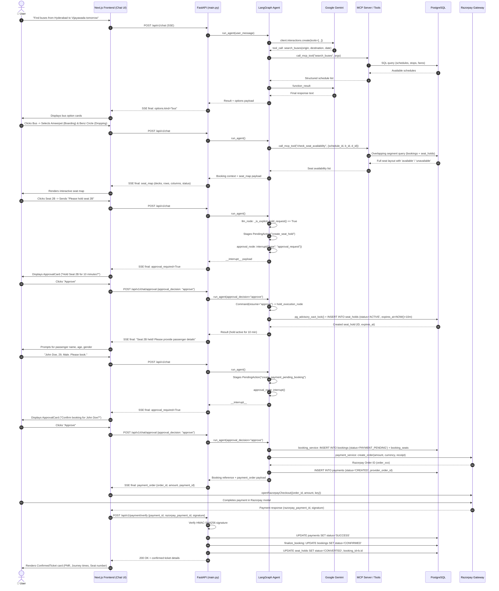

# Stage 03 — Intended Booking Workflow & Step-by-Step Verification

This document audits the entire 35-step end-to-end bus booking journey against the actual implementation in the codebase.

---

## 1. The 35-Step End-to-End Workflow Verification Matrix

| # | Step Description | Frontend Component | API Endpoint | Agent Node | MCP Tool (if any) | Backend Service | DB Table(s) | Validation Logic | Test Case | Status |
|---|---|---|---|---|---|---|---|---|---|---|
| **1** | User sends natural-language bus search | `BusBookingChat` (`bus-booking-chat.tsx:343`) | `POST /api/v1/chat` (`main.py:1133`) | Entry | None | `main.py:1147` | `conversations`, `conversation_turns` | Rate limit (20 req/min), message non-empty | `tests/test_conversations_api.py:23` | **Verified** |
| **2** | Gemini extracts origin, destination, date | `BusBookingChat` (shows live thinking step) | `POST /api/v1/chat` | `llm_node` (`test_integrated_agent.py:1785`) | None (LLM function call output) | Gemini 2.5 Flash (`client.interactions.create`) | None | System prompt rules 1-13; Pydantic schema `SearchBusesArguments` (`extra="forbid"`) | `tests/test_search_buses.py` | **Verified** |
| **3** | Agent requests search through MCP tool | N/A (background SSE step) | `POST /api/v1/chat` | `llm_node` → `tool_node` (`test_integrated_agent.py:2492`) | `search_buses` | `test_integrated_agent.py:801` (`call_mcp_tool`) | None | `validate_tool_arguments` (`test_integrated_agent.py:565`) | `tests/test_search_buses.py` | **Verified** |
| **4** | MCP server invokes custom Python tool | N/A | Subprocess stdio | Subprocess (`mcp_server.py`) | `search_buses_tool` | `search_buses.py:270` (`search_buses`) | None | JSON-RPC schema validation | `tests/test_search_buses.py` | **Verified** |
| **5** | Backend queries Supabase Postgres | N/A | Subprocess stdio | Subprocess | None (inside tool) | `search_buses.py:270` | `schedules`, `routes`, `route_stops`, `schedule_stops`, `fares`, `buses`, `operators` | SQL ILIKE search, sequence `<` check, date window [-2 days], departure time > now | `tests/test_segment_search.py:23` | **Verified** |
| **6** | Available schedules returned | N/A | `POST /api/v1/chat` (SSE `final` event) | `tool_node` → `llm_node` | None | `test_integrated_agent.py:2271` (`update_booking_context...`) | `conversation_turns` (turn metadata) | `validate_tool_result` (`test_integrated_agent.py:705`), `serialize_tool_result_for_llm` | `tests/test_search_buses.py` | **Verified** |
| **7** | Frontend shows buses | `SelectionOptions` (`selection-options.tsx:128`) | Client render | N/A | None | N/A | None | Render options payload (`kind === 'bus'`) | `tests/test_chat_components.py:48` | **Verified** |
| **8** | User selects a bus | `SelectionOptions` / prompt input | `POST /api/v1/chat` | `llm_node` | None | `_resolve_selected_bus` (`test_integrated_agent.py:1097`) | None | Deterministic matching against `available_schedules` (ordinal or operator+type) | `tests/test_seat_hold_workflow.py:120` | **Verified** |
| **9** | Boarding/dropping points for schedule retrieved | `AgentSteps` (shows "Loading bus details") | `POST /api/v1/chat` | `ensure_selected_schedule_details` (`test_integrated_agent.py:2389`) | `get_bus_details` | `call_mcp_tool` → `get_bus_details.py` | `schedules`, `buses`, `operators`, `routes`, `schedule_stops`, `route_stops` | Verified against selected schedule UUID | `tests/test_search_buses.py` | **Verified** |
| **10** | Frontend shows boarding on left, dropping on right | `SelectionOptions` (`selection-options.tsx:210`) | Client render | N/A | None | N/A | None | Two-column grid, `aria-disabled` for invalid pairs | `tests/test_chat_components.py:115` | **Verified** |
| **11** | Arrival/departure times from real schedule data | `SelectionOptions` | Client render | N/A | None | `schedule_time_utils.py:65` (`add_day_offsets`) | `schedule_stops` | Day offsets calculated from cross-midnight time wraps | `tests/test_schedule_time_utils.py:12` | **Verified** |
| **12** | User selects boarding and dropping points | `SelectionOptions` / chat message | `POST /api/v1/chat` | `_resolve_selected_stops` (`test_integrated_agent.py:1222`) | None | Deterministic string matcher | None | Subsumption filtering, trigger matching, sequence check (`boarding < dropping`) | `tests/test_seat_hold_workflow.py:180` | **Verified** |
| **13** | Journey segment validated | N/A | `POST /api/v1/chat` | `llm_node` / `tool_node` | `check_seat_availability` | `check_seat_availability.py:121` (`validate_journey_segment`) | `schedules`, `schedule_stops`, `route_stops` | Checks `is_boarding_allowed`, `is_dropping_allowed`, stops belong to route | `tests/test_seat_availability.py:40` | **Verified** |
| **14** | Applicable fare retrieved | `SelectionOptions` / Chat | Client / API | `tool_node` | None | `fares` table query | `fares` | Unique key `(schedule_id, boarding_stop_id, dropping_stop_id)` | `tests/test_segment_search.py:23` | **Verified** |
| **15** | Seat availability checked | `AgentSteps` ("Checking seat availability") | `POST /api/v1/chat` | `tool_node` | `check_seat_availability` | `call_mcp_tool` → `check_seat_availability.py` | `bus_seats`, `booking_seats`, `bookings`, `seat_holds` | Excludes confirmed bookings and active unexpired holds on overlapping segments | `tests/test_seat_availability.py:75` | **Verified** |
| **16** | Seat map displayed | `SeatMap` (`seat-map.tsx` / `bus-booking-chat.tsx:761`) | Client render | `_build_agent_payload` (`main.py:974`) | None | Inline payload in assistant message metadata | None | `seat_map_fresh` true only on initial turn; shows deck layouts (seater/sleeper) | `tests/test_seat_map.py:35` | **Verified** |
| **17** | User selects a seat | `SeatMap` (tap) / chat message | `POST /api/v1/chat` | `_resolve_selected_seat` (`test_integrated_agent.py:1369`) | None | Exact match on authoritative available seats | None | Must match `seat_number` and `status == 'available'` | `tests/test_seat_hold_workflow.py:280` | **Verified** |
| **18** | Seat selection alone does NOT create a hold | `BusBookingChat` (shows selection pill) | `POST /api/v1/chat` | `llm_node` (`test_integrated_agent.py:1955`) | None | Agent rule 22 | None | `_is_explicit_hold_request()` returns False → returns informational message only | `tests/test_seat_hold_workflow.py:310` | **Verified** |
| **19** | User explicitly requests a hold | Chat input ("Please hold seat 1B") | `POST /api/v1/chat` | `llm_node` (`test_integrated_agent.py:1948`) | `create_seat_hold` (Action tool) | `_is_explicit_hold_request()` returns True | None | Regex match on `\b(hold\|reserve\|lock)\b` | `tests/test_seat_hold_workflow.py:345` | **Verified** |
| **20** | Request validated | N/A | `POST /api/v1/chat` | `llm_node` (`test_integrated_agent.py:1984`) | None | `prepare_seat_hold_context` | None | Checks all 4 IDs present (`schedule_id`, `seat_id`, `boarding_stop_id`, `dropping_stop_id`) | `tests/test_seat_hold_workflow.py:380` | **Verified** |
| **21** | Human approval requested | `ApprovalCard` (`approval-card.tsx:25`) | `POST /api/v1/chat` (returns `approval_required: true`) | `approval_node` (`test_integrated_agent.py:2739`) | None | LangGraph `interrupt()` | Checkpoint tables | State saved to checkpoint pool before pausing graph | `tests/test_seat_hold_workflow.py:420` | **Verified** |
| **22** | Temporary seat hold created | `AgentSteps` ("Seat reserved") | `POST /api/v1/chat/approval` (`main.py:1215`) | `hold_execution_node` (`test_integrated_agent.py:2846`) | None | `hold_service.py:294` (`create_hold`) | `seat_holds` | `pg_advisory_xact_lock`, rechecks booking & hold overlap, sets `expires_at = NOW() + 10m` | `tests/test_seat_hold_workflow.py:465` | **Verified** |
| **23** | Passenger details collected | Chat message ("John Doe, 28, Male") | `POST /api/v1/chat` | `llm_node` | None | Prompt instructions (rule 26) | None | System prompt instructs agent to collect name, age, gender | `tests/test_booking_workflow.py:45` | **Verified** |
| **24** | Passenger info validated | N/A | `POST /api/v1/chat` | `llm_node` (`test_integrated_agent.py:2087`) | None | `validate_booking_arguments` (`create_booking.py`) | None | Pydantic schema: `name min_length=2`, `age 1-120`, `gender in MALE/FEMALE/OTHER` | `tests/test_booking_workflow.py:80` | **Verified** |
| **25** | User confirms booking | Chat message ("Confirm booking") | `POST /api/v1/chat` | `llm_node` (`test_integrated_agent.py:2085`) | `create_payment_pending_booking` (Action tool) | Agent rule 27 | None | Requires active unexpired hold, valid passenger details, explicit confirmation | `tests/test_booking_workflow.py:110` | **Verified** |
| **26** | Human approval for booking | `ApprovalCard` | `POST /api/v1/chat` | `approval_node` (`test_integrated_agent.py:2792`) | None | LangGraph `interrupt()` | Checkpoint tables | Checks pending action is `create_payment_pending_booking` | `tests/test_booking_workflow.py:140` | **Verified** |
| **27** | Payment-pending booking created | `PaymentCard` (`payment-card.tsx:30`) | `POST /api/v1/chat/approval` | `booking_execution_node` (`test_integrated_agent.py:3076`) | None | `booking_service.py:236` (`create_payment_pending_booking`) | `bookings`, `booking_seats` | `FOR UPDATE OF h`, verifies hold active/unexpired/owned, inserts `bookings` + `booking_seats` | `tests/test_booking_workflow.py:175` | **Verified** |
| **28** | Razorpay order created | N/A | `POST /api/v1/chat/approval` | `booking_execution_node` (`test_integrated_agent.py:3213`) | None | `payment_service.py:215` (`prepare_payment`), `RazorpayProvider` | `payments` | Creates order via Razorpay API, inserts `payments (status='CREATED')` | `tests/test_booking_workflow.py:210` | **Verified** (mocked in tests) |
| **29** | Frontend launches Razorpay Checkout | Razorpay modal (`bus-booking-chat.tsx:259`, `openRazorpayCheckout`) | Client browser | N/A | None | `window.Razorpay` script | None | Initiated with `order_id`, `amount`, `key_id` | Manual / E2E | **Implemented** (live requires key) |
| **30** | User pays in Razorpay modal | Razorpay external modal | External Gateway | N/A | None | Razorpay API | None | Card/UPI payment processing | External | **External** |
| **31** | Frontend submits payment response | `bus-booking-chat.tsx:272` | `POST /api/v1/payment/verify` (`main.py:484`) | N/A | None | `bus-agent.ts:160` (`verifyPayment`) | None | Sends `payment_id`, `razorpay_payment_id`, `razorpay_order_id`, `razorpay_signature` | `tests/test_booking_workflow.py:250` | **Verified** |
| **32** | Backend verifies payment signature | N/A | `POST /api/v1/payment/verify` | N/A | None | `payment_service.py:290` (`verify_payment`), `RazorpayProvider` | `payments` | HMAC-SHA256 signature verification over `order_id + '|' + payment_id` | `tests/test_booking_workflow.py:270` | **Verified** |
| **33** | Backend finalizes payment and booking | N/A | `POST /api/v1/payment/verify` | N/A | None | `booking_finalization_models.py:210` (`finalize_booking`) | `payments`, `bookings` | `FOR UPDATE OF p, b`, updates `payments.status = 'SUCCESS'`, `bookings.status = 'CONFIRMED'` | `src/.../test_booking_finalization.py:25` | **Verified** |
| **34** | Seat hold converted | N/A | `POST /api/v1/payment/verify` | N/A | None | `finalize_booking` (`booking_finalization_models.py:192`) | `seat_holds` | `UPDATE seat_holds SET status = 'CONVERTED', converted_at = NOW(), booking_id = :booking_id` | `src/.../test_booking_finalization.py:45` | **Verified** |
| **35** | Confirmed ticket displayed | `ConfirmedTicket` (`confirmed-ticket.tsx:35`) | Client render | N/A | None | `_get_confirmed_ticket_details` (`main.py:456`) | `bookings`, `booking_seats`, `bus_seats`, `schedules`, `buses`, `operators`, `routes`, `route_stops`, `schedule_stops` | Displays PNR, passenger info, seat number, boarding & dropping display times | `tests/test_confirmed_ticket_times.py:15` | **Verified** |

---

## 2. Diagram H — Booking & Payment Sequence

