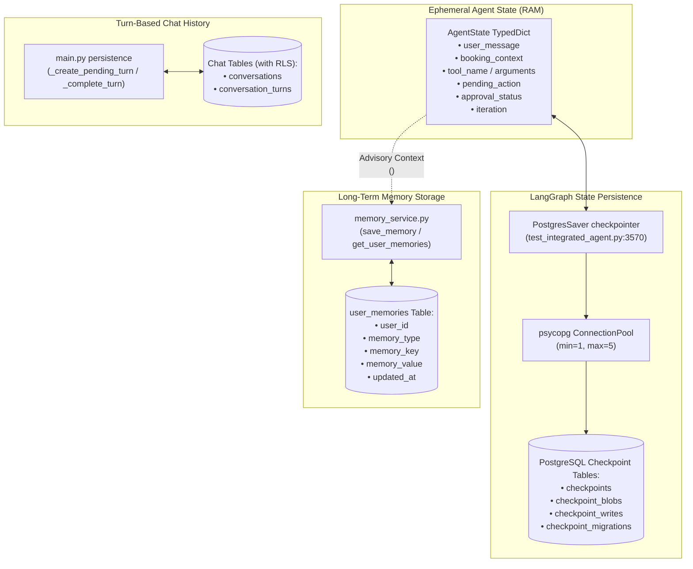
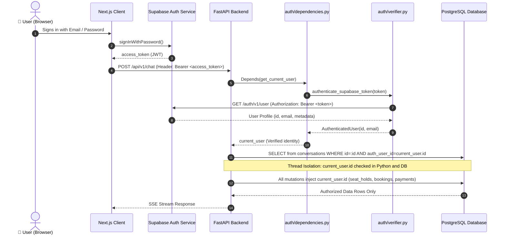
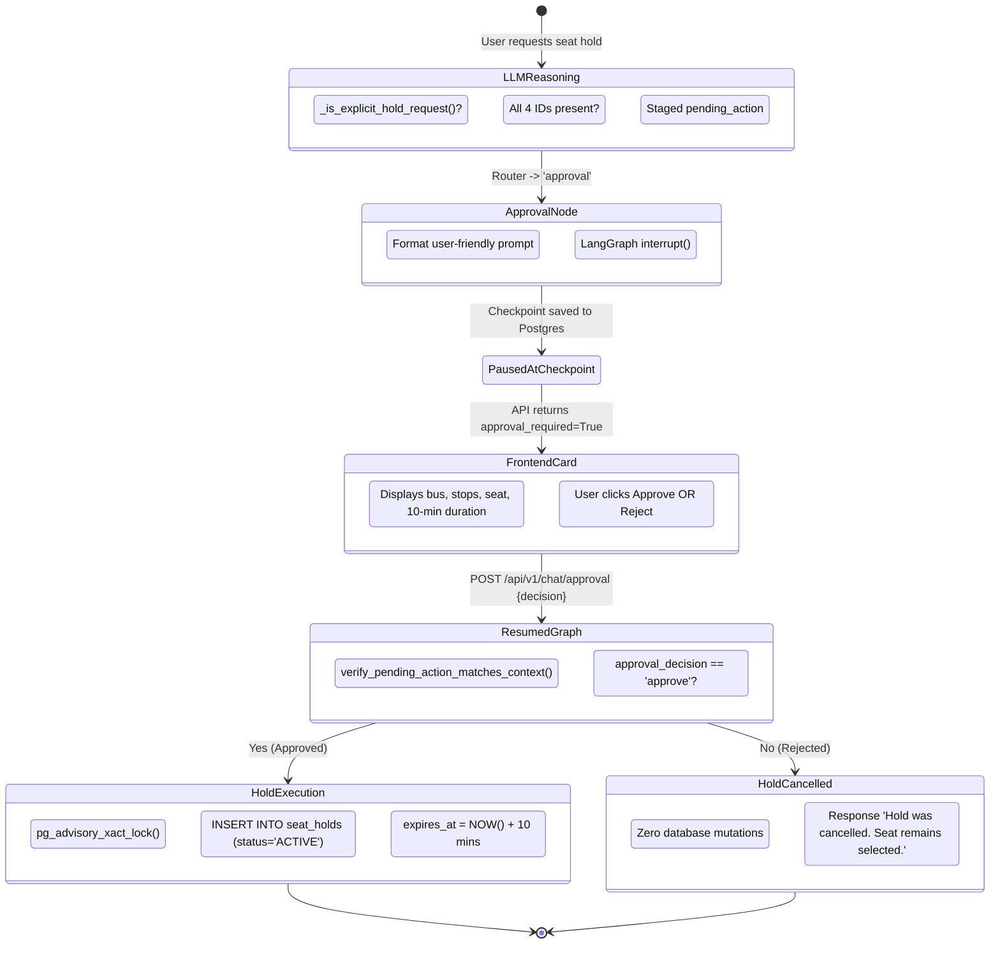

# Stage 05 — Curriculum Audit: Phases 05 to 07

## Scoring Formula
- **Completion %** = Verified / Total
- **Implementation %** = Implemented / Total
- **Testing %** = Tested / Total
- **Studied** = Documented evidence in repo; "Not determinable from repo" where absent.

---

# Phase 05: Memory + State

### Objective
Distinguish and implement short-term ephemeral runtime state (`AgentState`), long-term cross-session user memory (`user_memories` table), thread isolation, conversation history persistence (`conversations` and `conversation_turns`), and persistent LangGraph checkpointing via PostgreSQL (`PostgresSaver`).

### Files
- `src/bus_booking_ai_agent/phase_05_memory/memory_service.py`
- `src/bus_booking_ai_agent/phase_05_memory/memory_context.py`
- `src/bus_booking_ai_agent/phase_05_memory/memory_safety.py`
- `src/bus_booking_ai_agent/phase_05_memory/models.py`
- `src/bus_booking_ai_agent/phase_05_memory/test_persistent_agent_state.py`
- `src/bus_booking_ai_agent/phase_05_memory/test_short_term_memory.py`
- `src/bus_booking_ai_agent/phase_04_langgraph/test_integrated_agent.py:244-270` (`AgentState`), `3534-3578` (`PostgresSaver`)
- `main.py:673-818` (Conversation turn persistence)

### Test Files
- `tests/test_conversations_api.py`
- `tests/test_seat_hold_workflow.py`
- `src/bus_booking_ai_agent/phase_05_memory/test_persistent_agent_state.py`
- `src/bus_booking_ai_agent/phase_05_memory/test_short_term_memory.py`

### Plain-English Concept Explanations
- **State vs Memory**: Runtime state (`AgentState`) is ephemeral data held in RAM / checkpointer during graph execution (e.g., `iteration`, `tool_arguments`, `booking_context`). Memory is long-term knowledge persisting in the `user_memories` table (e.g. favorite seats, meal preferences).
- **Checkpointer Evolution**: Early learning experiments tested LangGraph `MemorySaver` (`phase_04_langgraph/test_agent_loop.py`), which lost state on process restart. The production graph uses **`PostgresSaver(checkpoint_pool)`** (`test_integrated_agent.py:3570-3578`), which writes state graphs and interrupts directly to PostgreSQL connection pool.
- **Thread Isolation**: The LangGraph thread ID is formatted as `f"{current_user.id}:{conversation_id}"` (`main.py:694, 733`). A user can never access or resume another user's checkpointed graph thread.
- **Memory Security & Safety**: `memory_safety.py:12` rejects sensitive information (passwords, credit cards, CVVs, tokens) before saving into `user_memories`. Furthermore, retrieved memories are explicitly framed as `<untrusted_memory>` in prompt construction so Gemini never treats them as system instructions or authoritative booking facts.

### Phase 05 Topic Matrix (23 Topics)

| # | Topic | Studied | Implemented | Tested | Verified | Status | Evidence (Path:Line) | Remaining Work |
|---|---|---|---|---|---|---|---|---|
| 1 | State vs memory | Studied | Implemented | Tested | Verified | Verified | `test_integrated_agent.py:244-270` vs `memory_service.py:1-40` | None |
| 2 | Agent runtime state | Studied | Implemented | Tested | Verified | Verified | `test_integrated_agent.py:244-270` (`AgentState`) | None |
| 3 | Short-term memory | Studied | Implemented | Tested | Verified | Verified | `phase_05_memory/test_short_term_memory.py:1-40` | None |
| 4 | Long-term memory | Studied | Implemented | Tested | Verified | Verified | `phase_05_memory/memory_service.py:83-117` (`save_memory`) | None |
| 5 | Conversation memory | Studied | Implemented | Tested | Verified | Verified | `main.py:737-817` (`conversation_turns` table) | None |
| 6 | User memory | Studied | Implemented | Tested | Verified | Verified | `phase_05_memory/memory_service.py:58-71` (`get_user_memories`) | None |
| 7 | Memory storage | Studied | Implemented | Tested | Verified | Verified | `phase_05_memory/memory_service.py:9-38` (PostgreSQL `user_memories`) | None |
| 8 | Memory retrieval | Studied | Implemented | Tested | Verified | Verified | `phase_05_memory/memory_context.py:10-25` (`get_relevant_memories`) | None |
| 9 | Memory updates | Studied | Implemented | Tested | Verified | Verified | `phase_05_memory/memory_service.py:22-29` (`ON CONFLICT DO UPDATE`) | None |
| 10 | Memory deletion | Studied | Implemented | Tested | Verified | Verified | `phase_05_memory/memory_service.py:74-81` (`delete_memory`) | None |
| 11 | Memory relevance | Studied | Implemented | Tested | Verified | Verified | `phase_05_memory/memory_context.py:10-25` | None |
| 12 | Memory context construction | Studied | Implemented | Tested | Verified | Verified | `test_integrated_agent.py:848-885` (`build_memory_context`) | None |
| 13 | Memory injection | Studied | Implemented | Tested | Verified | Verified | `test_integrated_agent.py:944-954` | None |
| 14 | Persistent agent state | Studied | Implemented | Tested | Verified | Verified | `test_integrated_agent.py:3570` (`PostgresSaver`) | None |
| 15 | Thread isolation | Studied | Implemented | Tested | Verified | Verified | `main.py:694` (`thread_id = f"{current_user.id}:{conversation_id}"`) | None |
| 16 | Conversation continuity | Studied | Implemented | Tested | Verified | Verified | `test_integrated_agent.py:3933-3975` | None |
| 17 | Checkpointing | Studied | Implemented | Tested | Verified | Verified | `test_integrated_agent.py:3570-3578` | None |
| 18 | Checkpoint restoration | Studied | Implemented | Tested | Verified | Verified | `test_integrated_agent.py:3659, 3863` (`graph.get_state`) | None |
| 19 | Memory security | Studied | Implemented | Tested | Verified | Verified | `phase_05_memory/memory_safety.py:1-60` (`validate_memory_value`) | None |
| 20 | Memory vs authoritative DB | Studied | Implemented | Tested | Verified | Verified | `test_integrated_agent.py:853` (advisory warning) | None |
| 21 | PostgreSQL-backed memory | Studied | Implemented | Tested | Verified | Verified | `phase_05_memory/memory_service.py:9` | None |
| 22 | LangGraph checkpoint persistence | Studied | Implemented | Tested | Verified | Verified | `test_integrated_agent.py:3551-3578` (`CheckpointPool` + `PostgresSaver`) | None |
| 23 | Gemini conversation continuation | Studied | Implemented | Tested | Verified | Verified | `test_integrated_agent.py:1727, 1747` (`previous_interaction_id`) | None |

### Phase 05 Metrics
- **Total Topics**: 23
- **Studied**: 23
- **Implemented**: 23
- **Tested**: 23
- **Verified**: 23
- **Completion %**: 100%
- **Status**: **COMPLETED**

---

# Phase 06: Guardrails + Security

### Objective
Implement defense-in-depth security: request authentication via Supabase JWT, authorization checks, Pydantic input/output schemas with `extra="forbid"`, tool allowlisting, prompt-injection defenses (untrusted data wrapping), database RLS, parameterized queries, rate limiting, and secret protection.

### Files
- `src/bus_booking_ai_agent/auth/verifier.py`
- `src/bus_booking_ai_agent/auth/dependencies.py`
- `src/bus_booking_ai_agent/auth/models.py`
- `src/bus_booking_ai_agent/phase_06_security/rate_limiter.py`
- `src/bus_booking_ai_agent/phase_06_security/test_rate_limiter.py`
- `src/bus_booking_ai_agent/phase_04_langgraph/test_integrated_agent.py:450-794` (Pydantic models, allowlist, guardrails)
- `bus_booking_agent_data/schema.sql:401-424` (RLS policies)

### Test Files
- `src/bus_booking_ai_agent/phase_06_security/test_rate_limiter.py`
- `tests/test_seat_hold_workflow.py` (verifies ownership enforcement, prompt injection defense, identifier spoofing rejection)
- `tests/test_booking_workflow.py` (verifies payment verification HMAC-SHA256)

### Plain-English Concept Explanations
- **Authentication**: `auth/verifier.py:16` contacts Supabase Auth `/auth/v1/user` with Bearer token. Identity is never accepted from the HTTP request body.
- **Backend Code Enforcement vs Prompt Description**: Crucial security principle: Security is enforced **in Python and SQL**, not trusted to prompt instructions. Tool arguments, ownership, hold validity, and fares are calculated/validated in Python. Prompts merely provide conversational guidance.
- **Prompt Injection Defense**: All external inputs (user message, memory, MCP tool results) are XML-tagged (`<untrusted_user_message>`, `<untrusted_memory>`, `<untrusted_tool_result>`) with explicit instructions telling the LLM to treat them purely as data and never as instructions.
- **SQL Injection Prevention**: 100% of SQL queries in the application use SQLAlchemy `text()` with named parameters (`:param`). Zero string concatenation.

### Phase 06 Topic Matrix (28 Topics)

| # | Topic | Studied | Implemented | Tested | Verified | Status | Enforcement Location | Evidence (Path:Line) |
|---|---|---|---|---|---|---|---|---|
| 1 | Input validation | Studied | Implemented | Tested | Verified | Verified | **BACKEND CODE** | `test_integrated_agent.py:450-484` |
| 2 | Output validation | Studied | Implemented | Tested | Verified | Verified | **BACKEND CODE** | `test_integrated_agent.py:705-760` |
| 3 | Pydantic validation | Studied | Implemented | Tested | Verified | Verified | **BACKEND CODE** | `test_integrated_agent.py:588` |
| 4 | Tool argument validation | Studied | Implemented | Tested | Verified | Verified | **BACKEND CODE** | `test_integrated_agent.py:565-598` |
| 5 | Tool allowlisting | Studied | Implemented | Tested | Verified | Verified | **BACKEND CODE** | `test_integrated_agent.py:508-513` |
| 6 | Unauthorized tool execution prevention | Studied | Implemented | Tested | Verified | Verified | **BACKEND CODE** | `test_integrated_agent.py:544-558` |
| 7 | Prompt injection defense | Studied | Implemented | Tested | Verified | Verified | **PROMPT + CODE WRAPPER** | `test_integrated_agent.py:91-113, 786-793, 938` |
| 8 | Untrusted context isolation | Studied | Implemented | Tested | Verified | Verified | **BACKEND CODE** | `test_integrated_agent.py:786-793, 861` |
| 9 | Memory safety | Studied | Implemented | Tested | Verified | Verified | **BACKEND CODE** | `phase_05_memory/memory_safety.py:12` |
| 10 | Tool result safety | Studied | Implemented | Tested | Verified | Verified | **BACKEND CODE** | `test_integrated_agent.py:705-760` |
| 11 | Authentication | Studied | Implemented | Tested | Verified | Verified | **BACKEND CODE** | `auth/verifier.py:16` |
| 12 | JWT validation | Studied | Implemented | Tested | Verified | Verified | **BACKEND CODE (Supabase)** | `auth/verifier.py:42` |
| 13 | Authorization | Studied | Implemented | Tested | Verified | Verified | **BACKEND CODE** | `auth/dependencies.py:28-35` |
| 14 | User identity | Studied | Implemented | Tested | Verified | Verified | **BACKEND CODE** | `auth/models.py:10` (`AuthenticatedUser`) |
| 15 | Conversation ownership | Studied | Implemented | Tested | Verified | Verified | **BACKEND CODE + SQL** | `main.py:700` (`WHERE auth_user_id = :user_id`) |
| 16 | Thread isolation | Studied | Implemented | Tested | Verified | Verified | **BACKEND CODE** | `main.py:694, test_integrated_agent.py:3683` |
| 17 | Database RLS | Studied | Implemented | Tested | Verified | Verified | **DATABASE (Postgres)** | `bus_booking_agent_data/schema.sql:401-424` |
| 18 | SQL injection prevention | Studied | Implemented | Tested | Verified | Verified | **BACKEND CODE (SQLAlchemy)** | `search_buses.py`, `hold_service.py` |
| 19 | Parameterized queries | Studied | Implemented | Tested | Verified | Verified | **BACKEND CODE** | Throughout all tool/service SQL strings |
| 20 | Secret management | Studied | Implemented | Tested | Verified | Verified | **ENVIRONMENT (.env)** | `.gitignore`, `config/gemini.py`, `config/database.py` |
| 21 | Rate limiting | Studied | Implemented | Tested | Verified | Verified | **BACKEND CODE (Redis/Memory)**| `main.py:650-667`, `rate_limiter.py:1-60` |
| 22 | Abuse prevention | Studied | Implemented | Tested | Verified | Verified | **BACKEND CODE** | Rate limits + `MAX_ITERATIONS = 5` |
| 23 | Booking-context validation | Studied | Implemented | Tested | Verified | Verified | **BACKEND CODE** | `test_integrated_agent.py:605-691` |
| 24 | Internal identifier validation | Studied | Implemented | Tested | Verified | Verified | **BACKEND CODE** | `test_integrated_agent.py:614-690` |
| 25 | Seat-hold ownership | Studied | Implemented | Tested | Verified | Verified | **BACKEND CODE + SQL** | `hold_service.py:444, 480` |
| 26 | Booking ownership | Studied | Implemented | Tested | Verified | Verified | **BACKEND CODE + SQL** | `booking_service.py:249`, `payment_service.py:161` |
| 27 | Payment verification security | Studied | Implemented | Tested | Verified | Verified | **BACKEND CODE** | `payment_service.py:290-340` (HMAC-SHA256) |
| 28 | Error handling without leaking secrets | Studied | Implemented | Tested | Verified | Verified | **BACKEND CODE** | `main.py:1094-1102`, `test_integrated_agent.py:3051` |

### Phase 06 Metrics
- **Total Topics**: 28
- **Studied**: 28
- **Implemented**: 28
- **Tested**: 28
- **Verified**: 28
- **Completion %**: 100%
- **Status**: **COMPLETED**

---

# Phase 07: Human-in-the-Loop (HITL)

### Objective
Implement sensitive action detection and human approval workflows via LangGraph `interrupt()`; checkpoint state before pause; support asynchronous client resumption via `Command(resume=...)`; guarantee idempotency and verify that rejected actions never execute.

### Files
- `src/bus_booking_ai_agent/phase_04_langgraph/test_integrated_agent.py:2739-2840` (`approval_node`), `2846-3044` (`hold_execution_node`), `3076-3324` (`booking_execution_node`), `3648-3850` (Approval resume)
- `main.py:1215-1330` (`/api/v1/chat/approval`)
- `frontend/components/chat/approval-card.tsx`
- `frontend/lib/api/bus-agent.ts:133-158` (`sendApprovalDecision`)

### Test Files
- `tests/test_seat_hold_workflow.py` (Tests approval, rejection, state resumption, context drift invalidation)
- `tests/test_booking_workflow.py` (Tests booking HITL approval and rejection)

### Plain-English Concept Explanations
- **Sensitive Action Detection**: Not every action is sensitive. Reading buses and checking availability are harmless read-only operations. Creating a database seat hold (which locks a seat from other users for 10 minutes) and creating a financial booking are sensitive actions requiring explicit human approval.
- **LangGraph `interrupt()`**: In `approval_node()` (`test_integrated_agent.py:2811`), the graph calls `interrupt({...})`. LangGraph immediately serializes the current graph state to PostgreSQL and stops execution.
- **Graph Resumption with `Command(resume=...)`**: When the user clicks "Approve" or "Reject" on `ApprovalCard`, the frontend calls `POST /api/v1/chat/approval`. The backend invokes `graph.invoke(Command(resume=approval_decision), config=config)`. The execution resumes exactly at `approval_node`!
- **Rejection Enforcement**: In both `hold_execution_node` (lines 2857-2874) and `booking_execution_node` (lines 3090-3104), if `approval_status == "rejected"`, the database transaction is **bypassed completely**. No seat hold or booking is created, and the graph safely returns a cancellation message.

### Phase 07 Topic Matrix (20 Topics)

| # | Topic | Studied | Implemented | Tested | Verified | Status | Evidence (Path:Line) | Remaining Work |
|---|---|---|---|---|---|---|---|---|
| 1 | HITL fundamentals | Studied | Implemented | Tested | Verified | Verified | `test_integrated_agent.py:2739-2840` | None |
| 2 | Approval workflows | Studied | Implemented | Tested | Verified | Verified | `test_integrated_agent.py:2820, 2846` | None |
| 3 | Rejection workflows | Studied | Implemented | Tested | Verified | Verified | `test_integrated_agent.py:2828, 2861` | None |
| 4 | Sensitive action detection | Studied | Implemented | Tested | Verified | Verified | `test_integrated_agent.py:1948, 2085` | None |
| 5 | Pending actions | Studied | Implemented | Tested | Verified | Verified | `test_integrated_agent.py:180-186` (`PendingAction`) | None |
| 6 | LangGraph interrupt() | Studied | Implemented | Tested | Verified | Verified | `test_integrated_agent.py:2811` (`interrupt(...)`) | None |
| 7 | Checkpointing before interrupt | Studied | Implemented | Tested | Verified | Verified | `test_integrated_agent.py:3570` (`PostgresSaver`) | None |
| 8 | Graph resumption | Studied | Implemented | Tested | Verified | Verified | `test_integrated_agent.py:3841-3845` | None |
| 9 | Command(resume=...) | Studied | Implemented | Tested | Verified | Verified | `test_integrated_agent.py:3841` (`Command(resume=...)`) | None |
| 10 | Approval state | Studied | Implemented | Tested | Verified | Verified | `test_integrated_agent.py:2824` (`approval_status = "approved"`) | None |
| 11 | Rejection state | Studied | Implemented | Tested | Verified | Verified | `test_integrated_agent.py:2832` (`approval_status = "rejected"`) | None |
| 12 | Action validation before approval | Studied | Implemented | Tested | Verified | Verified | `test_integrated_agent.py:1576-1614` (`verify_pending_action...`) | None |
| 13 | Approval expiration | Studied | Implemented | Tested | Verified | Verified | `test_integrated_agent.py:1546-1562, 1860-1884` | None |
| 14 | Duplicate approval requests | Studied | Implemented | Tested | Verified | Verified | `test_integrated_agent.py:3728-3777` | None |
| 15 | Idempotency | Studied | Implemented | Tested | Verified | Verified | `test_integrated_agent.py:3728-3777` (returns existing active hold) | None |
| 16 | Frontend approval interfaces | Studied | Implemented | Tested | Verified | Verified | `frontend/components/chat/approval-card.tsx:25` | None |
| 17 | Backend approval endpoints | Studied | Implemented | Tested | Verified | Verified | `main.py:1215-1330` (`/api/v1/chat/approval`) | None |
| 18 | Seat-hold approval | Studied | Implemented | Tested | Verified | Verified | `test_integrated_agent.py:2786, 2846` | None |
| 19 | Booking approval | Studied | Implemented | Tested | Verified | Verified | `test_integrated_agent.py:2792, 3076` | None |
| 20 | Human auth vs agent decisions | Studied | Implemented | Tested | Verified | Verified | `test_integrated_agent.py:2885, 3115` (`current_user` in config) | None |

### Phase 07 Metrics
- **Total Topics**: 20
- **Studied**: 20
- **Implemented**: 20
- **Tested**: 20
- **Verified**: 20
- **Completion %**: 100%
- **Status**: **COMPLETED**

---

## Diagram E — Memory and Checkpointing Architecture

---

## Diagram F — Authentication and Authorization Flow

---

## Diagram G — Human-in-the-Loop Approval Workflow

